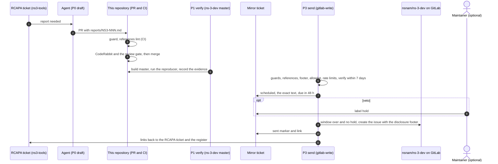
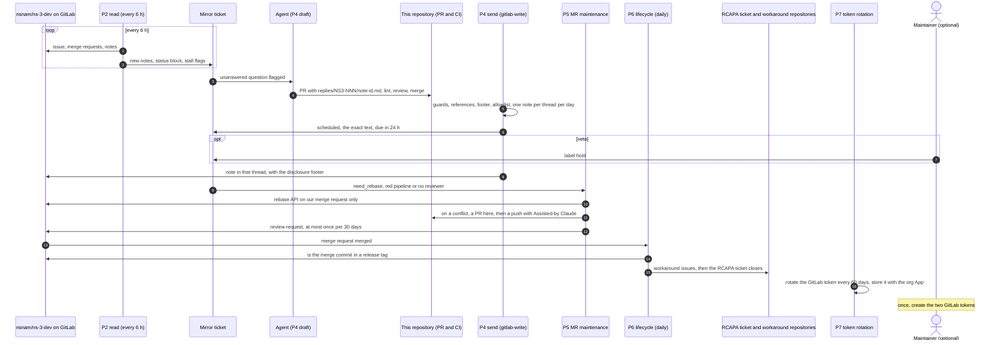

# ns3-upstream-report

<!-- org-sync:begin badges -->
| Group | Badges |
| --- | --- |
| Build |  |
| Release |  |
| Trust |  |
| Stack |  |
| Community & docs |  |
<!-- org-sync:end badges -->

The bridge between the swarm-routing org and ns-3's GitLab
([`nsnam/ns-3-dev`](https://gitlab.com/nsnam/ns-3-dev)). The org finds bugs in
upstream ns-3 while benchmarking; each gets an `NS3-NNN` id, an RCAPA (root
cause analysis) and an RCAPA ticket in
[swarm-routing/ns3-tools](https://github.com/swarm-routing/ns3-tools/blob/main/docs/ns3-bugs.md).
When one is reported upstream, its **mirror ticket** here follows the GitLab
side, and the reports and replies go out from here, each only after the
maintainer approves it.

**Status (2026-11-16): the design is decided
([ADR-0002](docs/adr/0002-a-zero-manual-pipeline-to-ns-3s-gitlab.md), #2).
P2 read runs every 6 h; P0 draft, P1 verify (`verify.yml`), P3 publish and
P4 reply and P5 MR maintenance (`send.yml`), P6 lifecycle (`lifecycle.yml`)
and P7 credentials (`rotate.yml`) are built with their guards (#2).** Nothing reaches GitLab until the
maintainer has stored the GitLab tokens.

## How it works

Nobody operates this repository by hand. Each upstream report is a mirror
ticket here, and pipelines carry it from the first draft to the fix shipping
in an ns-3 release. An agent drafts every text as a pull request; CI checks
it; a merged file is announced on its mirror ticket and goes out after a
veto window. The maintainer appears only as the optional `hold` label and
the one-time token bootstrap.

### Report and publish

### Track, reply, maintain, release

| Pipeline | Workflow | What it does |
|----------|----------|--------------|
| P0 draft | a pull request | an agent writes `reports/NS3-NNN.md` (first line `# <GitLab title>`) or `replies/NS3-NNN/<note-id>.md` from the RCAPA document; CI's `upstream.py lint` checks it |
| P2 read | [`read.yml`](.github/workflows/read.yml), every 6 h | for every item of [`tracked.toml`](tracked.toml): opens its mirror ticket if it has none, fetches each GitLab issue and merge request (state, `detailed_merge_status`, reviewers, approvals, head pipeline, labels) into the ticket's status block, adds each new GitLab note as a comment (author, date, link; deduplicated by note id), and comments when the stall flags change: no activity for 14 days, `need_rebase` or conflicts, no reviewer, an unanswered question, a competing merge request. Runs without a token (GitLab's public pages) |
| P1 verify | [`verify.yml`](.github/workflows/verify.yml), weekly and on a register change | for each open item with a `reproduce` table: builds ns-3-dev `master` with the `ns3-dev` toolchain, runs the reproducer, and records the result on the mirror ticket; a report is sent only after a "reproduces" from the last 7 days |
| P6 lifecycle | [`lifecycle.yml`](.github/workflows/lifecycle.yml), daily | when an `ns-3.X` tag contains the merge commit of our merge request: "fixed in ns-3.X" on the ticket, one issue per workaround, and the RCAPA ticket closed when they are all closed |
| P5 MR maintenance | [`send.yml`](.github/workflows/send.yml), with P3/P4 | on our merge requests: `need_rebase` → GitLab's rebase API; a conflict → asks for the resolved series as `patches/NS3-NNN/<mr>/` by PR (each commit with `Assisted-by: Claude`), then pushes it to our fork's source branch with `--force-with-lease`; no reviewer a week after our answer → a fixed review request, at most once per 30 days. Each waits out the veto window |
| P7 credentials | [`rotate.yml`](.github/workflows/rotate.yml), weekly | rotates each environment's GitLab token at 60 days and stores the new one with the org App's token, checked first; a failure opens an issue |
| P3 publish, P4 reply | [`send.yml`](.github/workflows/send.yml), hourly and on a merge | the plan job (no secret) checks the guards and schedules each post on its ticket with the exact text; the send job (environment `gitlab-write`) posts what is due and links it back |

`tracked.toml` is the register and the allowlist: one `[[item]]` per report
(its `NS3-NNN` id, title, state, RCAPA ticket, GitLab issue, merge requests,
competing merge requests, mirror ticket, P1 evidence, optional `gate`), and
the gate policy (`veto-window`, 24 h for a note, 48 h for a new issue). An
item enters only by a reviewed pull request. Each mirror ticket links its
RCAPA ticket in swarm-routing/ns3-tools, and the RCAPA ticket links back.

## Security

- **Every actor may be an agent.** Agents act on GitHub as the maintainer's
  own user, so no comment author, association or approval click can tell
  them apart; a required reviewer would add a click, not a control. The
  guards therefore assume an agent wrote everything
  ([ADR-0002](docs/adr/0002-a-zero-manual-pipeline-to-ns-3s-gitlab.md)).
  A separate agent identity is swarm-routing/.github#523.
- **Text only from merged files.** Nothing in a comment is ever sent; every
  post was reviewed as a pull request and passed CI.
- **Guards before every API call** (`tools/upstream/upstream.py`; a failure
  stops the post and comments why on the ticket): references (no bare `#N`,
  `!N` or `owner/repo#N` that GitLab would link to the wrong place; our items
  as full GitHub URLs, ns-3 items as `nsnam/ns-3-dev#N` or a full GitLab URL),
  the fixed disclosure footer ("Posted by swarm-routing's upstream bridge;
  drafted with AI assistance (Claude) and checked by its CI, not written by
  hand."), the scope allowlist (`nsnam/ns-3-dev` only, issues and notes on
  the item's own threads, never a close, label, approval or merge), rate
  limits (one new issue a day, one note per thread a day), and fresh P1
  verify evidence for a new report.
- **The veto window.** Each post is announced on its mirror ticket with its
  exact text, 24 h ahead (48 h for a new issue); the `hold` label stops it.
- **The token lives in the environments**, never in a repository secret:
  `gitlab-read` (`read_api`, optional) and `gitlab-write` (`api`,
  `write_repository`), both deploying from `main` only, both code in
  `.github/org-sync.toml`. Jobs holding the token run only `main`'s code, use
  only GitHub's and the org's own actions, and every action is pinned by SHA; no workflow runs
  on a fork's pull request with a secret.
- **GitLab text is data.** Notes quoted here are neutralised (no hidden
  markers, no `@mentions`, no `#N` links).

See [SECURITY.md](SECURITY.md) for the trust boundary and how to report a
vulnerability.

<!-- org-sync:begin develop -->
## Develop

New here? [docs/development.md](docs/development.md) is the developer guide:
the tools to install, how to get the code and its dependencies, how to
build, test, run and lint it, the Docker images, what CI checks and how to
read a red run. How changes are proposed, reviewed and released is the org's
[CONTRIBUTING.md](https://github.com/swarm-routing/.github/blob/main/CONTRIBUTING.md).
<!-- org-sync:end develop -->

## Contributing

Contributions from forks are welcome: see
[Outside contributions](https://github.com/swarm-routing/.github/blob/main/CONTRIBUTING.md#outside-contributions)
(sign off every commit with `git commit -s`).

## Licence

See [LICENSING.md](LICENSING.md).
