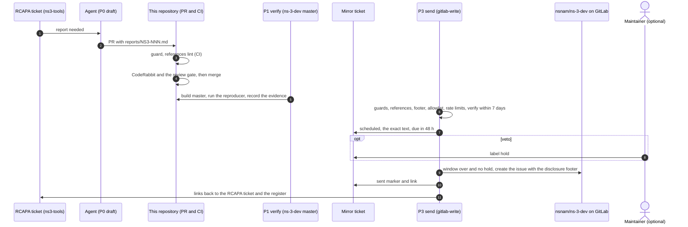
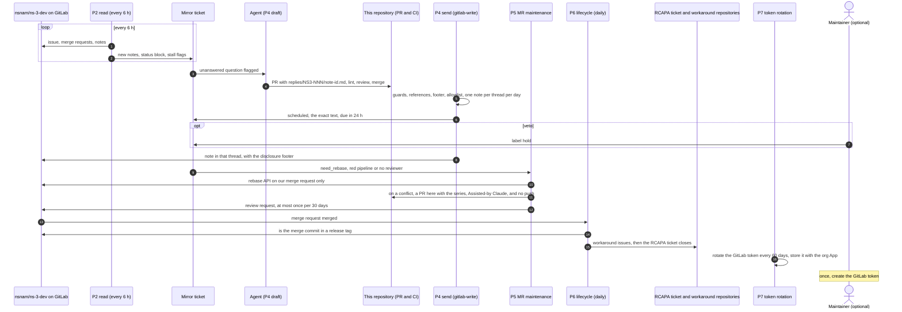

# ns3-upstream-report

<!-- org-sync:begin badges -->
| Group | Badges |
| --- | --- |
| Build |  |
| Release |    |
| Trust |   |
| Stack |  |
| Community & docs |   |
<!-- org-sync:end badges -->

The bridge between the swarm-routing org and ns-3's GitLab
([`nsnam/ns-3-dev`](https://gitlab.com/nsnam/ns-3-dev)). The org finds bugs in
upstream ns-3 while benchmarking; each gets an `NS3-NNN` id, an RCAPA (root
cause analysis) and an RCAPA ticket in
[swarm-routing/ns3-tools](https://github.com/swarm-routing/ns3-tools/blob/main/docs/ns3-bugs.md).
When one is reported upstream, its **mirror ticket** here follows the GitLab
side, and the reports and replies go out from here, each only after the
maintainer approves it.

**Status (2026-11-16): the design is decided
([ADR-0002](docs/adr/0002-a-zero-manual-pipeline-to-ns-3s-gitlab.md), #2),
and every pipeline is one Go tool, `cmd/upstream`
([ADR-0003](docs/adr/0003-the-bridge-is-go.md)). P2 read runs every 6 h;
P0 draft, P1 verify (`verify.yml`), P3 publish and P4 reply (`send.yml`),
P5 MR maintenance (`maintain.yml`), P6 lifecycle (`lifecycle.yml`) and P7
credentials (`rotate.yml`) run with their guards.** The one GitLab token
(scope `api`) is stored in both environments.

## How it works

Nobody operates this repository by hand. Each upstream report is a mirror
ticket here, and pipelines carry it from the first draft to the fix shipping
in an ns-3 release. An agent drafts every text as a pull request; CI checks
it; a merged file is announced on its mirror ticket and goes out after a
veto window. The maintainer appears only as the optional `hold` label and
the one-time token bootstrap.

### Report and publish

### Track, reply, maintain, release

| Pipeline | Workflow | What it does |
|----------|----------|--------------|
| P0 draft | a pull request | an agent writes `reports/NS3-NNN.md` (first line `# <GitLab title>`) or `replies/NS3-NNN/<note-id>.md` from the RCAPA document; CI's `upstream lint` checks it |
| P2 read | [`read.yml`](.github/workflows/read.yml), every 6 h | for every item of [`tracked.toml`](tracked.toml): opens its mirror ticket if it has none, fetches each GitLab issue and merge request (state, `detailed_merge_status`, reviewers, approvals, head pipeline, labels) into the ticket's status block, adds each new GitLab note as a comment (author, date, link; deduplicated by note id), and comments when the stall flags change: no activity for 14 days, `need_rebase` or conflicts, no reviewer, an unanswered question, a competing merge request; with the token, an issue 30 days before it expires. Runs without a token too (GitLab's public pages); built without the GitLab write client |
| P1 verify | [`verify.yml`](.github/workflows/verify.yml), weekly and on a register change | for each open item with a `reproduce` table: builds ns-3-dev `master` with the `ns3-dev` toolchain, runs the reproducer, and records the result on the mirror ticket; a report is sent only after a "reproduces" from the last 7 days |
| P6 lifecycle | [`lifecycle.yml`](.github/workflows/lifecycle.yml), daily and after every send run | when an `ns-3.X` tag contains the merge commit of the fix (our merge request, a `competing` one, or another that closed the item's GitLab issue; only read, never written to): "fixed in ns-3.X" on the ticket, one issue per workaround, and the RCAPA ticket closed when they are all closed; when a report was published (`upstream-sent: publish`) and `tracked.toml` lacks its issue, the org bot's pull request that sets `state = "published"` and `issue` |
| P3 publish, P4 reply | [`send.yml`](.github/workflows/send.yml), hourly and on a merge | the plan job (no secret) checks the guards and schedules each post on its ticket with the exact text; the send job (environment `gitlab-write`) posts what is due and links it back |
| P5 MR maintenance | [`maintain.yml`](.github/workflows/maintain.yml), daily | on our open merge requests: `need_rebase` → GitLab's rebase API after the 24 h window, once per head; a conflict → a pull request here with the merge request's series in `patches/NS3-NNN/<mr>/` (commit with `Assisted-by: Claude`), where it stops: the token has no `write_repository`, so nothing is pushed to GitLab; no reviewer 7 days after our last note → a fixed review request, at most once per 30 days |
| P7 credentials | [`rotate.yml`](.github/workflows/rotate.yml), weekly | checks the org App can store the environment secrets (else an issue names the missing permission), then rotates the token once it is 60 days old (90-day expiry) and stores it in both environments |

`tracked.toml` is the register and the allowlist: one `[[item]]` per report
(its `NS3-NNN` id, title, state, RCAPA ticket, GitLab issue, merge requests,
competing merge requests, mirror ticket, P1 evidence and reproducer, workaround
issues, optional `gate`), and
the gate policy (`veto-window`, 24 h for a note, 48 h for a new issue). An
item enters only by a reviewed pull request. Each mirror ticket links its
RCAPA ticket in swarm-routing/ns3-tools, and the RCAPA ticket links back.

## Security

- **Every actor may be an agent.** Agents act on GitHub as the maintainer's
  own user, so no comment author, association or approval click can tell
  them apart; a required reviewer would add a click, not a control. The
  guards therefore assume an agent wrote everything
  ([ADR-0002](docs/adr/0002-a-zero-manual-pipeline-to-ns-3s-gitlab.md)).
  A separate agent identity is swarm-routing/.github#523.
- **Text only from merged files.** Nothing in a comment is ever sent; every
  post was reviewed as a pull request and passed CI.
- **Guards before every API call** (`cmd/upstream`, `internal/`; a failure
  stops the post and comments why on the ticket): references (no bare `#N`,
  `!N` or `owner/repo#N` that GitLab would link to the wrong place; our items
  as full GitHub URLs, ns-3 items as `nsnam/ns-3-dev#N` or a full GitLab URL),
  the fixed disclosure footer ("Posted by swarm-routing's upstream bridge;
  drafted with AI assistance (Claude) and checked by its CI, not written by
  hand."), the scope allowlist (`nsnam/ns-3-dev` only, issues and notes on
  the item's own threads, never a close, label, approval or merge), rate
  limits (one new issue a day, one note per thread a day), and fresh P1
  verify evidence for a new report.
- **The veto window.** Each post is announced on its mirror ticket with its
  exact text, 24 h ahead (48 h for a new issue); the `hold` label stops it.
- **The token lives in the environments**, never in a repository secret:
  one GitLab token, scope `api` (no `write_repository`; the maintainer's
  decision of 2026-11-16), stored as `GITLAB_TOKEN` in `gitlab-read` and
  `gitlab-write`, both deploying from `main` only, both code in
  `.github/org-sync.toml`. Read and lifecycle are built without the GitLab
  write client (a test enforces it); P7 rotates the token every 60 days.
  Jobs holding the token run only `main`'s code, use only GitHub's own, the
  org's and this repository's actions, and every action is pinned by SHA;
  no workflow runs on a fork's pull request with a secret.
- **GitLab text is data.** Notes quoted here are neutralised (no hidden
  markers, no `@mentions`, no `#N` links).

See [SECURITY.md](SECURITY.md) for the trust boundary and how to report a
vulnerability.

<!-- org-sync:begin develop -->
## Develop

New here? [docs/development.md](docs/development.md) is the developer guide:
the tools to install, how to get the code and its dependencies, how to
build, test, run and lint it, the Docker images, what CI checks and how to
read a red run. How changes are proposed, reviewed and released is the org's
[CONTRIBUTING.md](https://github.com/swarm-routing/.github/blob/main/CONTRIBUTING.md).
Whether a regression here gets an RCAPA (root cause analysis with corrective
and preventive actions), and how: [docs/rcapa/README.md](docs/rcapa/README.md).
<!-- org-sync:end develop -->

<!-- org-sync:begin citing -->
## Releases & citing

Versions follow [SemVer](https://semver.org). Each release is listed under [Releases](https://github.com/swarm-routing/ns3-upstream-report/releases), built by the org's release workflow and archived on [Zenodo](https://zenodo.org) with its own DOI.

To cite this repository, use the “Cite this repository” button (from [CITATION.cff](CITATION.cff)). It has no DOI yet: the concept DOI appears here and in the badge above once Zenodo archives its first release.

Using it in your work? Contributions are welcome, and citing it helps just as much.
<!-- org-sync:end citing -->

## Contributing

Contributions from forks are welcome: see
[Outside contributions](https://github.com/swarm-routing/.github/blob/main/CONTRIBUTING.md#outside-contributions)
(sign off every commit with `git commit -s`).

## Epics

<!-- epics:begin -->
<!-- Generated by swarm-routing/.github tools/epics/epics.py from the issues labelled `epic`; edit the issues, then re-run it. -->

What is planned and in progress here: the issues labelled [`epic`](https://github.com/swarm-routing/ns3-upstream-report/issues?q=label%3Aepic). An epic's open sub-issues carry a `priority:*` and a `model:*` label, so a contributor or an AI agent can pick one up ([how issues work](https://github.com/swarm-routing/.github/blob/main/CONTRIBUTING.md#issues)). The whole org's plan: the [roadmap](https://github.com/swarm-routing/.github/blob/main/ROADMAP.md#epics).

| Epic | Status | Sub-issues closed |
|------|--------|-------------------|
| [#2](https://github.com/swarm-routing/ns3-upstream-report/issues/2) zero-manual upstream reporting: draft, verify, publish, track, reply, maintain, release | Planned | 0 / 1 |

<!-- epics:end -->

## Licence

See [LICENSING.md](LICENSING.md).
